[English](README.md) · [Українська](README.uk.md) · [Русский](README.ru.md)

🌐 All our programs: https://drugoj00.github.io/

# Smart Life for Windows

Smart Life sockets in a Windows window: tiles with buttons, timers, your own scenes and schedules.

A free Windows program that shows the sockets and switches of your Smart Life (Tuya) account in one tidy window. Switch them on and off with the mouse, set timers, build your own scenes, run schedules and open every home in a separate window. Sign-in needs no password: you scan the QR code in the program window once with the Smart Life scanner.

⭐ If the program is useful, please star this repository: it costs nothing and helps other people find it.

## Download

**Version 3.3.** [SmartLifeForWindows-3.3.exe](https://github.com/drugoj00/smart-life-for-windows/releases/latest) (Assets) · [Releases](https://github.com/drugoj00/smart-life-for-windows/releases)

SHA-256: `6392062b9f5977c15c710b05d26d9a128256bc099296f9fe8fab84f3c8d4c150`

## What's new in 3.3

- The installer is smaller.

## Features

- Socket tiles grouped by home: name, state (on, off, offline) and a large round power button like in the Smart Life app. The state refreshes by itself every 12 seconds.
- Wide tiles: any tile can be stretched to two columns with a right click or the “Wide tile” checkbox in the device window (like the “P C” card in the app).
- Device window: click a tile to open a window with a big button, electricity (power, voltage, current, energy), the socket timer and settings, as in the Smart Life app.
- Tile order: drag tiles with the mouse, the order is remembered for each home (by default as Tuya returns it).
- A turn-off timer on every tile (15 minutes, 30 minutes, 1, 2 or 4 hours).
- Multi-channel sockets and power strips: a device with several channels (230 V and USB, socket 1, 2, 3) gets a button per channel on its tile and in the device window; the common “turn on/off” (tray menu, “Turn everything off”, scenes, schedules, timer) acts on all channels.
- Confirmation before turning off important sockets (computer, router and others; the list can be changed).
- A “Turn everything off” button for a home (important sockets are left alone).
- A separate window for each home: right-click the home button. Windows remember their size and position and reopen at start.
- Tray icon by the clock: click it to show or hide the window; the menu has your favourite sockets (● on, ○ off; add them with a right click on a tile → “Show in the tray menu”), all sockets by home, “Turn everything off”, your scenes and “Quit”. The window’s cross only hides it: the program and the icon stay by the clock. “Start with Windows (in the tray)” can be switched on in the tray icon menu and in “⋯”: the program starts when you sign in to Windows as an icon only, without a window.
- Your own scenes: a set of sockets with “turn on” or “turn off”, run with one button.
- Schedules: at a chosen time and weekdays turn a socket on or off or run your own scene.
- Smart Life tap-to-run scenes appear on their own tab if you have any.
- Light and dark themes; Russian, Ukrainian and English (by Windows language or chosen manually).
- Tiles adapt to the window size: all of them fit, and when space is tight the window scrolls row by row.
- QR sign-in without a password (the user code is remembered) and a backup email and password sign-in with a country list.
- Device codes: a table that assigns power, voltage, current and energy for any device; automatic detection of the Tuya block, pasting codes from a received text.
- Energy use: consumption for today, 7 and 30 days and the cost at your price per kWh.
- Power protection: a device turns off when the power stays above a threshold longer than the set time.
- Desktop shortcuts for sockets and your own scenes: run without a window, with a result message within a second.
- Windows notifications: a device went offline or came back, a schedule, timer or protection fired.
- Server agent: schedules, scenes and power protection keep working while the computer is off (the Server folder).
- Transfer view: tile order and wide tiles are saved to a file and loaded on another computer.
- Your own device icons in five places: next to the name (large), instead of the power button (the picture fills the whole circle), as the tile background, as the device window background and as the background of all program windows. Any picture or file works (png, jpg, gif, webp, svg, even an exe icon), ready-made emoji, a picture from the clipboard and dragging a file onto a tile. Each place keeps its own icon: changing one does not touch the others.
- Animated icons and backgrounds: GIF and WebP, and also video. Choose a part up to 30 seconds with two handles (start and end), and the program builds a light animation of the right size.
- Program window background: your own colour, picture, GIF or video. Dimming and blur are set for each background separately and for all at once (“⋯” → “Window background…”).
- Readable text over a background: over a picture or video the labels adapt to the brightness of the background (light on dark, black on light) and get a thin outline or a soft glow; the font stays the same.
- Energy “from the grid” and “to the grid” for bidirectional meters (import and export): the codes are picked up automatically or assigned in “Device codes”.
- Dual tariff: a day price and a night price with your own night hours; the cost of consumption uses both prices.
- Tooltips on every button, compact menus and lists, a drawn check mark on checked boxes, an About window.

## Screenshots

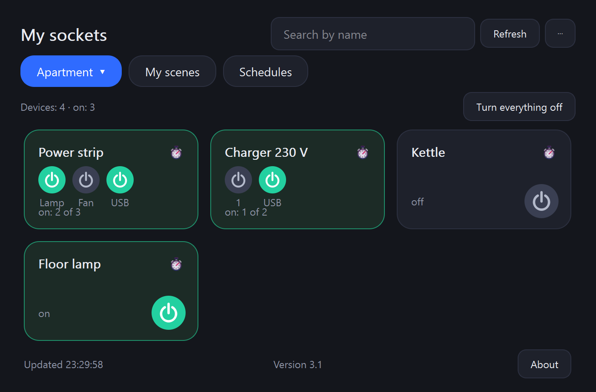

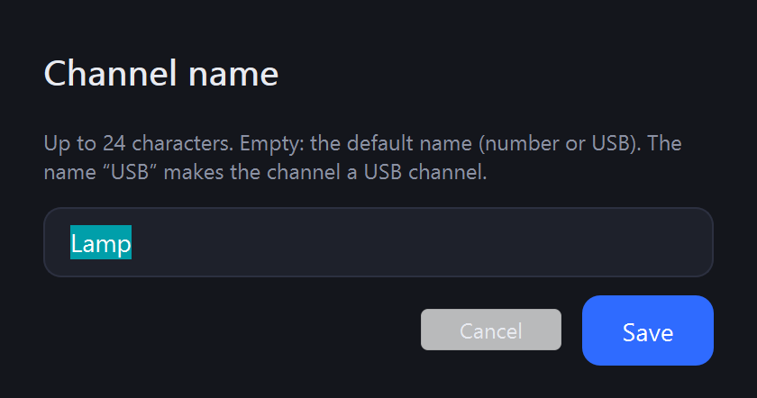

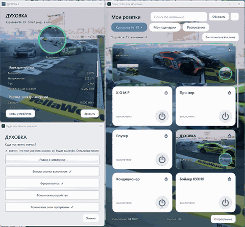

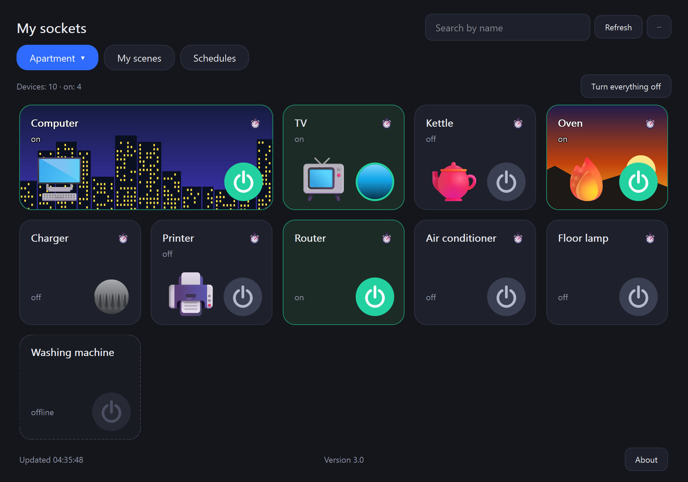

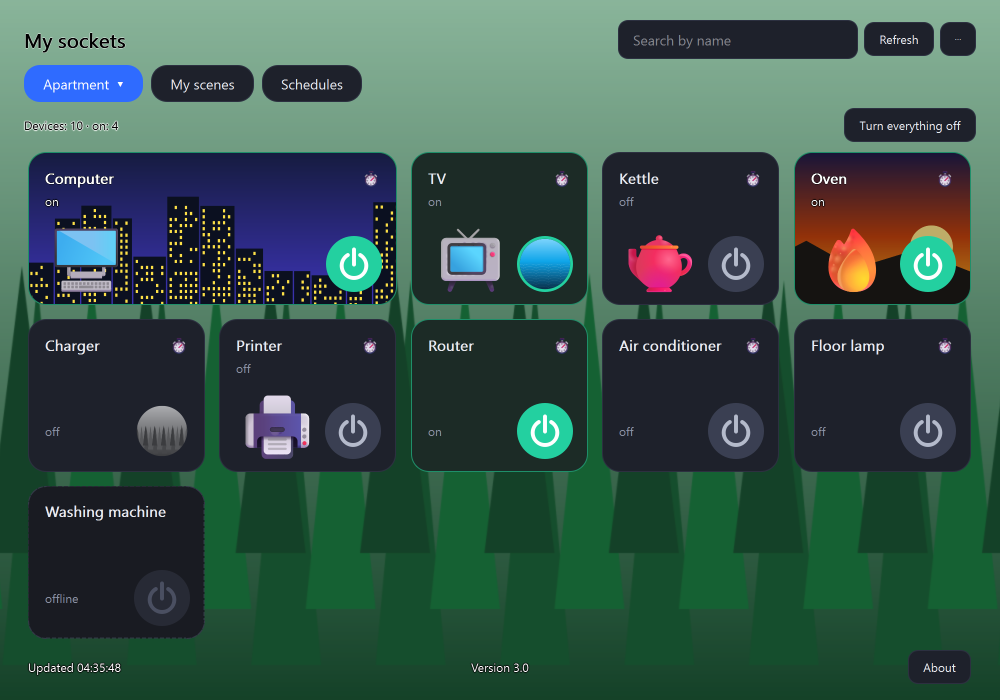

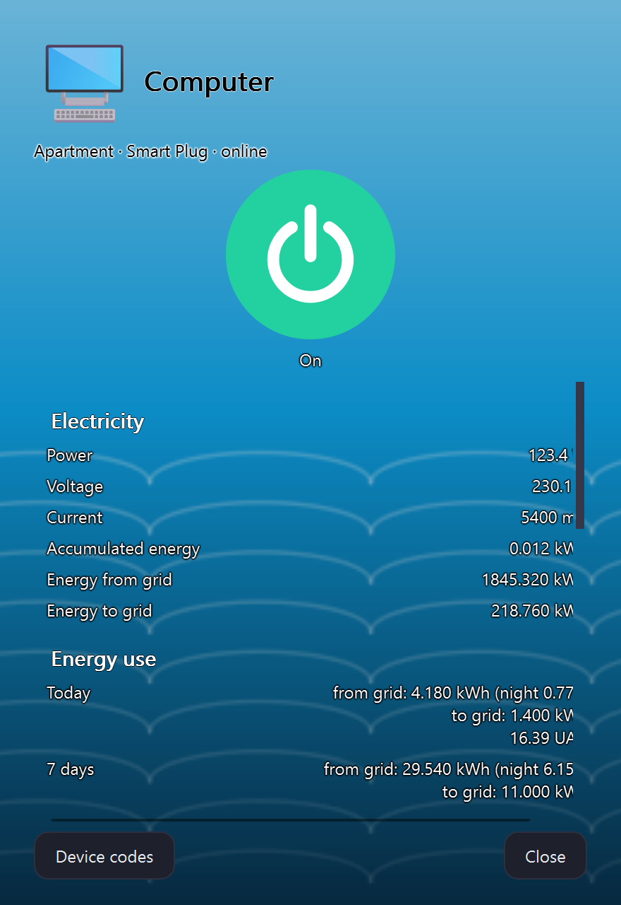

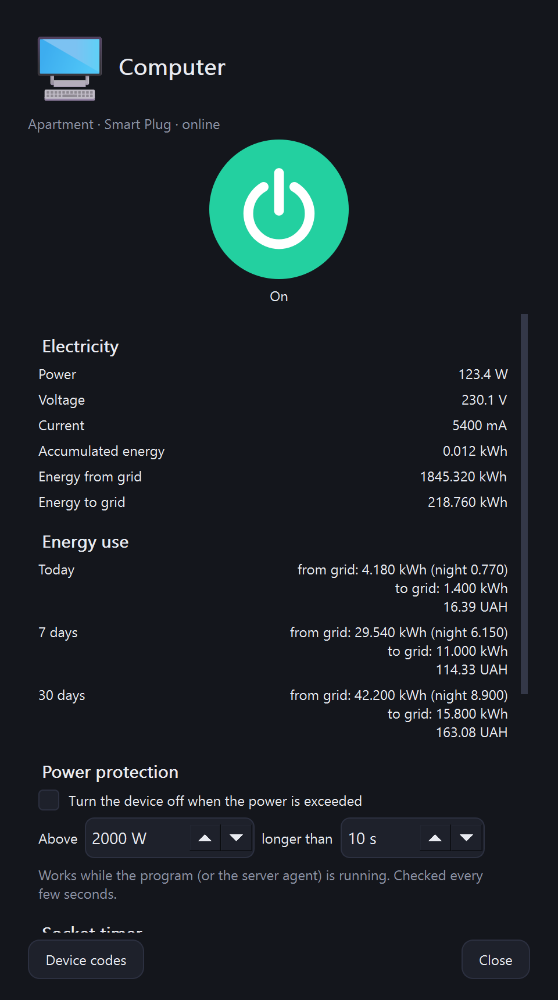

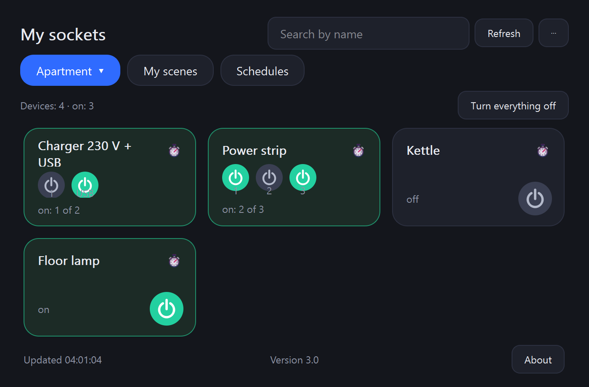

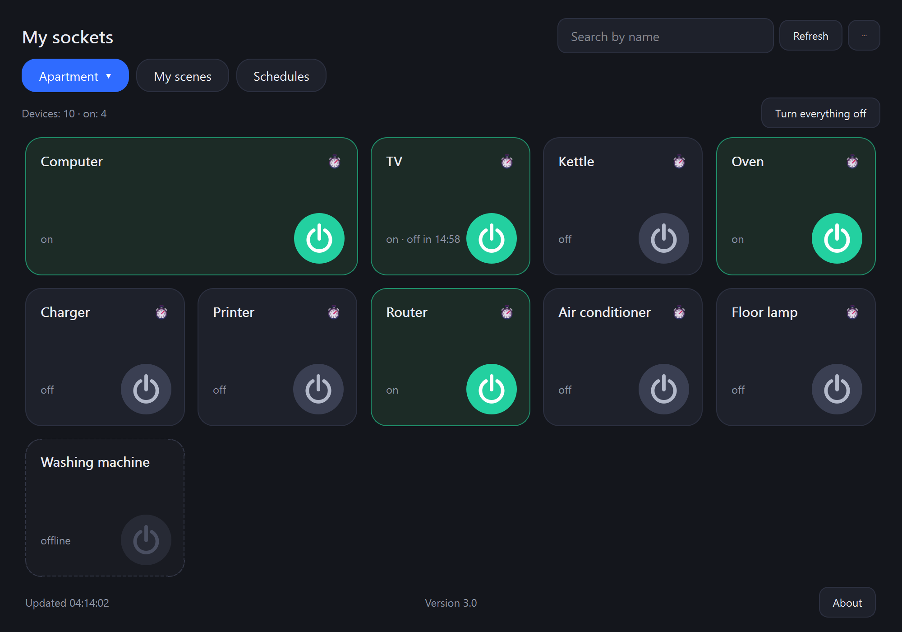

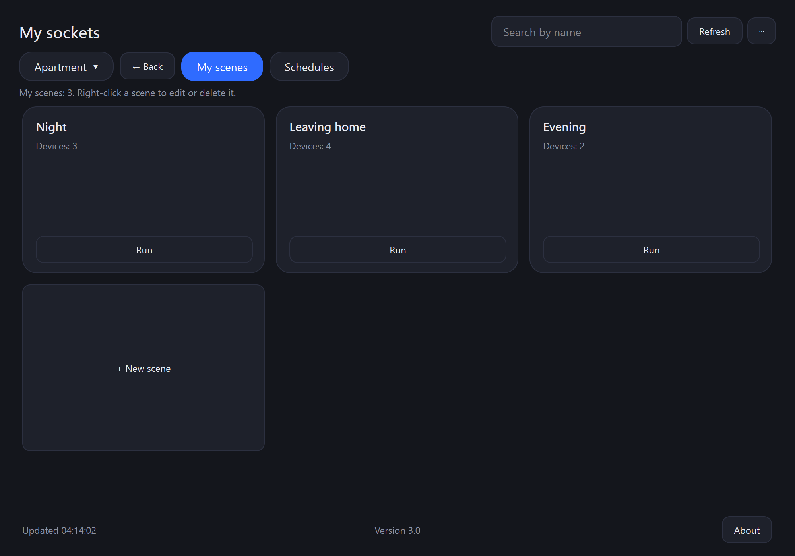

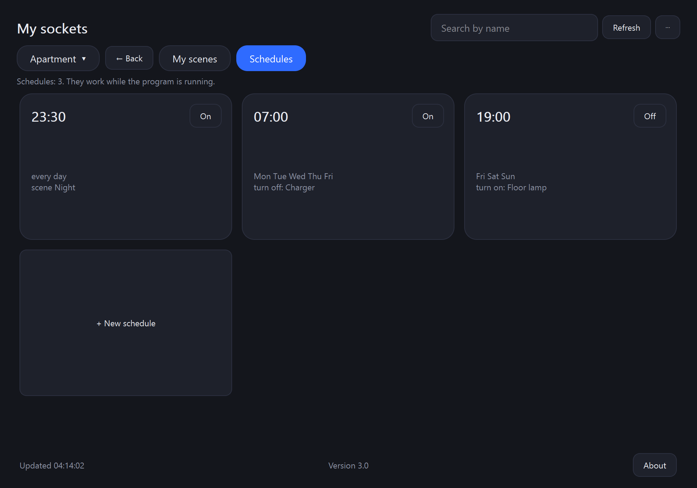

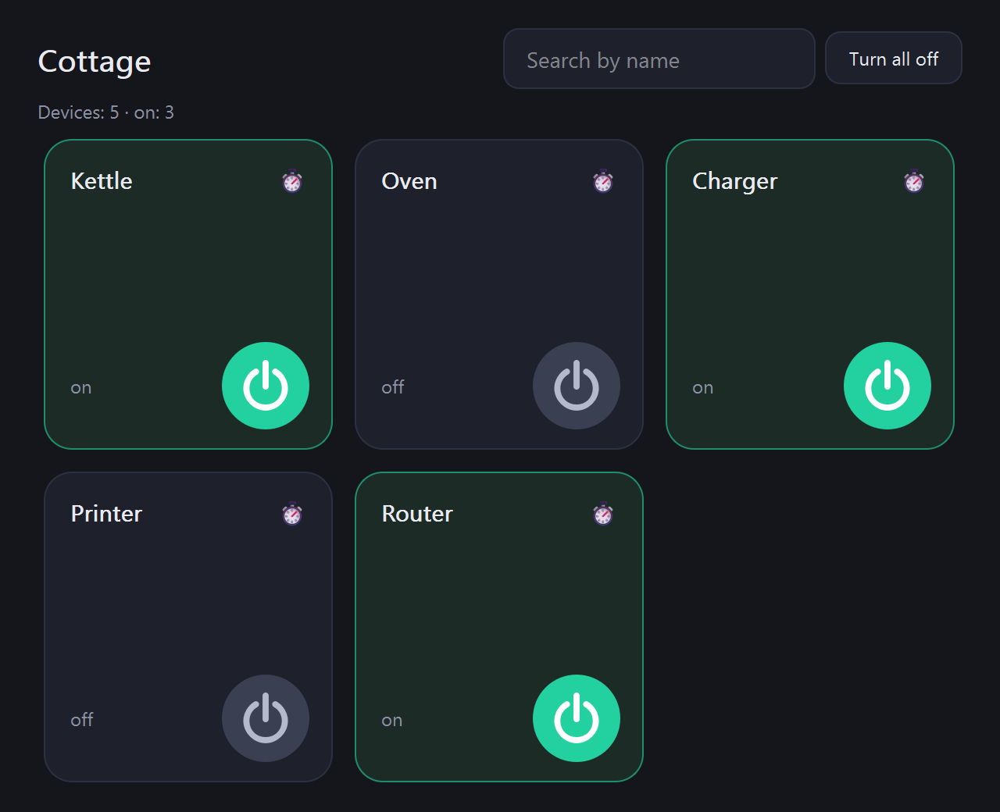

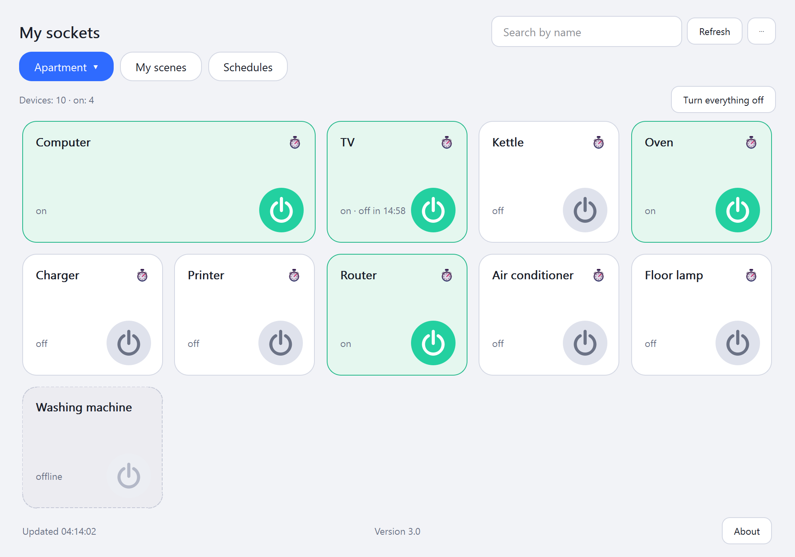

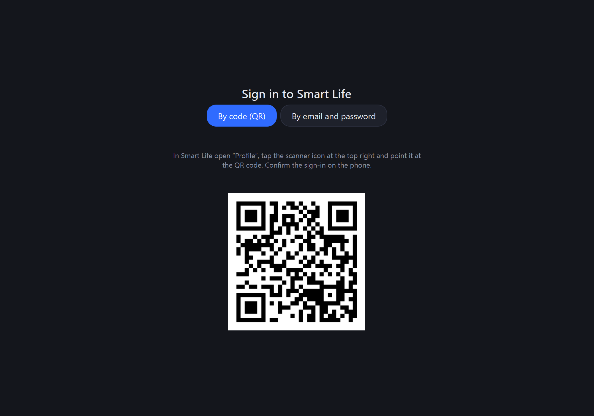

## Requirements

Windows 10 or 11 (64-bit); a Smart Life (or Tuya Smart) account and a phone with the app for the first sign-in; internet. Administrator rights are optional.

## Detailed guide

### 1. Installation

Download the installer SmartLifeForWindows-3.3.exe and run it. Windows asks for permission: the program is installed into C:\Program Files\SmartLifeForWindows. If you decline, it goes into your user folder. In the installer window you can add a desktop shortcut (off by default) and launch the program right away. A Start menu shortcut is always created. The installer language (Russian, Ukrainian, English) follows the Windows language and can be changed with the list in the top right corner of the window.

Uninstall it the usual way: Windows Settings → Apps. The uninstaller asks whether to delete the saved sign-in too.

The installer is not signed with a publisher certificate yet, so Windows may show a SmartScreen warning (“Unknown publisher”): click “More info”, then “Run anyway”.

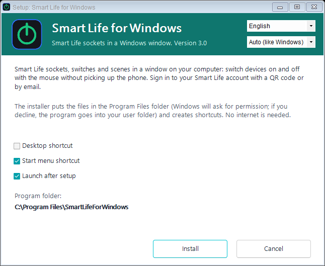

### 2. First sign-in (once)

The program asks for neither an email nor a password. Sign-in goes through a QR code, as in Home Assistant:

1. In the Smart Life app open “Profile” → gear icon → “Account and Security” → “User Code” and copy or remember it (about 7 characters).
2. In the program, on the “By code (QR)” tab, enter the code (if it is already in the clipboard it is filled in by itself) and press “Next”. A QR code appears.
3. In Smart Life open “Profile”, tap the scanner icon at the top right and point it at the QR code in the window. Confirm the sign-in on the phone.

You can sign in with an account created through Google or by email: the program never sees the password, it only receives permission from Tuya to control the sockets.

The user code is remembered. After that the program signs in by itself and renews the session by itself: no scanning is needed until you press “Sign out” or Tuya resets the session (once every few months). After “Sign out” the QR code appears at once, you only need to point the scanner.

### 3. Main window

At the top is a button with the name of the current home: click it and a list of all homes of the account opens (as in the Smart Life app); choose the one you need. The program remembers the last open home (the “My scenes” and “Schedules” tabs are not remembered). Next to it are the “My scenes” and “Schedules” tabs; on them a “← Back” button appears to the right of the home name and returns you to the home you were in. Below are the socket tiles of the selected home. A tile shows the name, the state (on, off, offline) and a round power button: green when on, grey when off, dimmed with a dashed border when the device is offline. Press the button to toggle the socket. The search box at the top finds sockets by name; “Refresh” updates the state at once (otherwise it updates by itself every 12 seconds). Sockets toggled on the phone are picked up within a few seconds.

### 4. Wide tiles

In the Smart Life app some cards (for example “P C”) take two columns. That depends on the app settings and is not visible in the device data, so in the program you choose the width yourself: right-click the tile → “Stretch to two columns” (and “Normal size” to undo). Wide tiles come first and the choice is remembered. You can also preset wide tiles with a list of names: the config.json file, key wide (for example, ["P C"]).

### 5. Device window

Click a tile (not the power button): the device window opens, as in the app. It has a big power button, electricity (power, voltage, current, accumulated energy, if the socket measures them), the socket timer (in how many minutes it switches itself), child lock and indicator light. Settings are available with the QR login; the data refreshes by itself. Tiles can still be dragged by their background: a click opens the window, a drag changes the order.

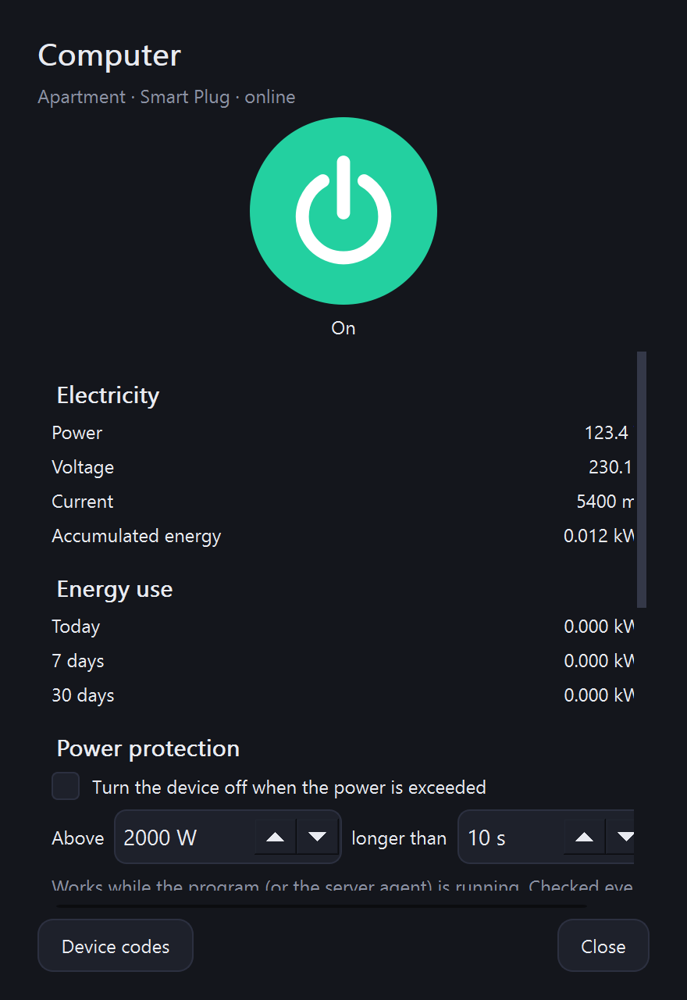

### 6. Tile order

Tuya gives third-party programs the devices in its own order (by the time they were added), while the order of cards in the Smart Life app (for example in “Favorites”) is stored inside the app and is not exposed. So the order is set separately in the program: take a tile with the mouse by its background (not by the power button) and drag it onto another tile; it takes that tile's place. The order is remembered for each home and is used in home windows. Dragging works in a home without a search filter. Menu “⋯” → “Reset tile order” returns Tuya's order. You can also preset the order in config.json: key order, for example {"Apartment": ["P C", "Printer"]}.

### 7. Turn-off timer

Click the alarm-clock icon in the tile corner and choose “Turn off in 15 minutes / 30 minutes / 1 hour / 2 hours / 4 hours”. If the socket is off, it is turned on first and then off by the timer. The tile shows the time left. The timer can be cancelled in the same menu. Timers work while the program is running and are shared by all program windows.

### 8. Important sockets and “Turn everything off”

Before turning off important sockets (by default “P C”, “K O M P”, “L E N O V O” and “Router”) the program asks for confirmation, so that an accidental click does not switch off your computer or internet. The list can be changed: the config.json file in the program data folder (see “Where the data is stored”), key protected.

The “Turn everything off” button switches off all sockets that are on in the selected home except the important ones, and asks for confirmation first. The same button is in separate home windows.

### 9. A separate window for each home

Click the home name button at the top → “Open in a separate window” → the home you need (or right-click that button: the window of the current home opens). A home window can be placed on a second monitor or next to other windows. It has its own search and a “Turn everything off” button. Windows remember their size and position, and the open ones reopen at the next start. Close a window with the cross or with the same menu (“Close separate window”). The state of the sockets and the timers are shared by all windows.

### 10. My scenes

The “My scenes” tab: press “+ New scene”, type a name, tick sockets and choose “Turn on” or “Turn off” for each, press “Save”. A scene runs with the “Run” button on its tile. Right-click a tile: “Edit” or “Delete”. If a scene turns off important sockets, the program asks for confirmation. Your scenes are stored in the program (not in Smart Life) and work while the program is running.

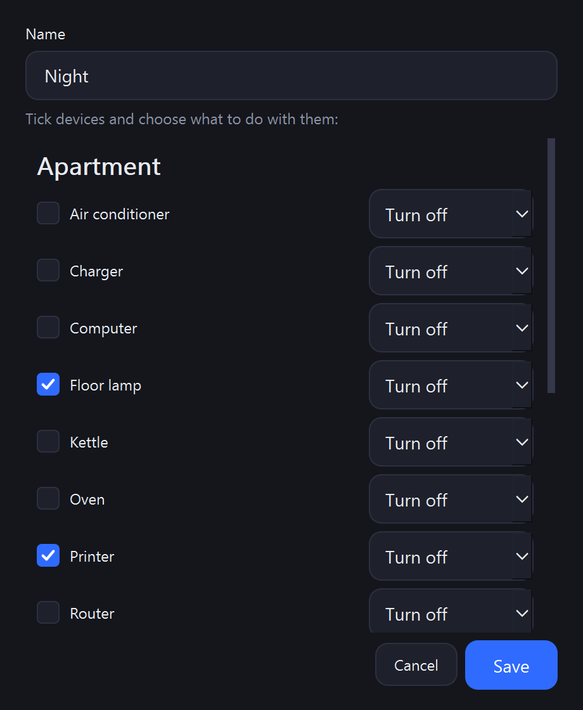

### 11. Schedules

The “Schedules” tab: “+ New schedule” → choose what to switch (a socket or your own scene), the action, the time and the weekdays. The “On/Off” switch on the tile disables a schedule temporarily; right-click: “Edit” or “Delete”. Schedules fire only while the program is running and the computer is awake. For round-the-clock operation use automations in Smart Life itself.

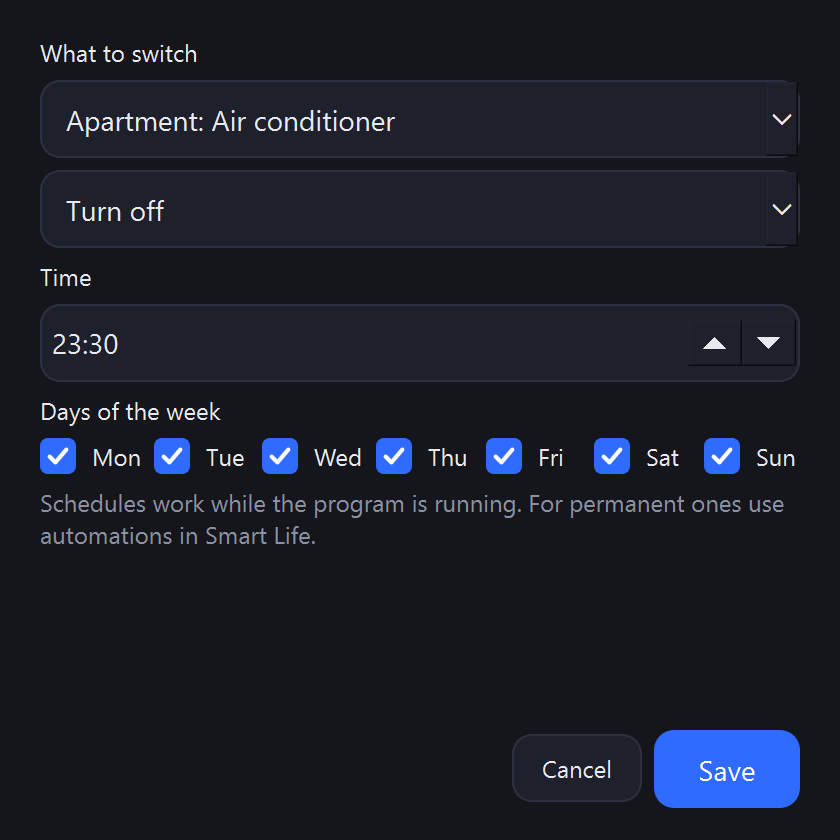

### 12. Smart Life scenes

If you have “tap-to-run” scenes in the Smart Life app, the program shows a “Scenes” tab with a “Run” button for each. Smart Life automations (by schedule and conditions) are not provided to third-party programs by Tuya: they are not visible in the program and keep working in the app as before.

### 13. Theme, language, window size

The “⋯” button at the top right: “Theme” (Auto like Windows, Light, Dark), “Language” (Auto, Русский, Українська, English; the program restarts after you choose) and “Sign out”. The default language is taken from the Windows language.

The window’s cross only hides it by the clock: the program and the icon stay; to quit, right-click the tray icon → “Quit”. The same menu has a switch “Start with Windows (in the tray)” (when you sign in to Windows the program starts minimized to the tray). Tray icon by the clock: a click shows or hides the window, a right click opens the menu: open the window, favourite sockets (● on, ○ off; a click switches it, important sockets ask for confirmation), “All sockets” by home, “Turn everything off”, “My scenes”, “Quit”. Favourites are set with a right click on a tile → “Show in the tray menu”.

On the very first start the window is narrow (two columns). Window sizes and positions are remembered. If all tiles do not fit, they become more compact; when it is tight even so, a scroll bar appears and the mouse wheel scrolls one row at a time, so the last row is never cut off.

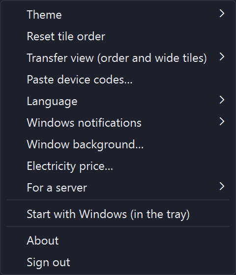

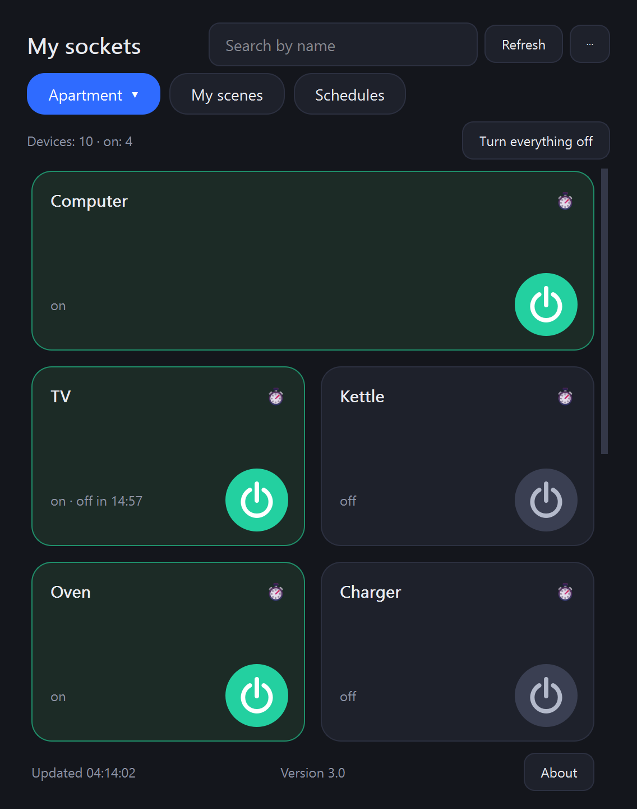

### 14. Email and password sign-in (backup)

The sign-in screen has a “By email and password” tab: email, password, the account country (a list with flags) and the app type. This is an old Tuya method: it shows one flat list of devices without homes and without scenes, and it does not accept every account (for some accounts Tuya answers “wrong login” even when the password is right). Google sign-in is not possible here. QR sign-in is more reliable.

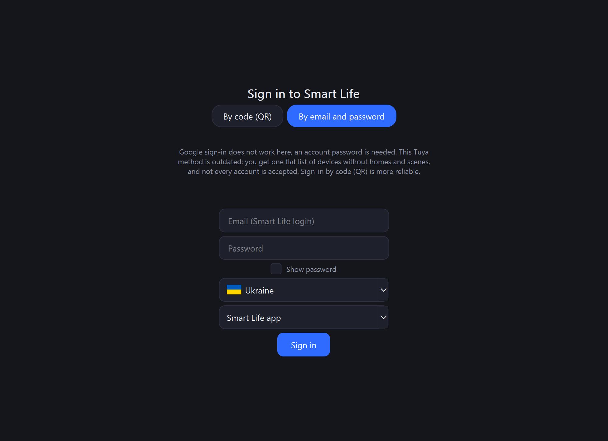

### 15. Device codes

If a device shows no power or voltage, open its window and click “Device codes”. In the table choose for each numeric code what it means (power, voltage, current, energy), set a divisor if needed (10, 100, 1000) and check the Reading column against the Smart Life app. Click Save: the readings appear in the Electricity block and the setting is remembered for all devices of this model. The standard Tuya block (phase_a) is detected automatically.

“Copy codes” copies the list of codes as text (without the device name, id and keys) to send to the developer. “⋯” → “Paste device codes…” parses such a text sent by another user.

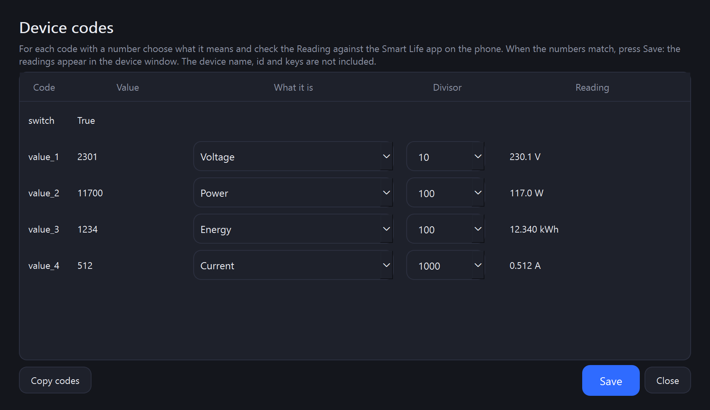

### 16. Energy use and power protection

A device window with a power reading or an energy counter shows the consumption for today, 7 and 30 days (counted while the program runs). “⋯” → “Electricity price…”: the day price per kWh and the currency, for example “0.15 EUR”; if you like, switch on “Night tariff”, set the night price and the night hours (23 to 7 by default), and the cost uses both prices. The program logs consumption by the hour since version 3.0; earlier days are priced at the day price.

Bidirectional meters (for example with solar panels) show “Energy from grid” (import) and “Energy to grid” (export), and the device window splits consumption into “from grid” and “to grid”. The standard codes forward_energy_total and reverse_energy_total are picked up automatically, others are assigned in “Device codes” (the roles “Energy from grid” and “Energy to grid”).

Power protection: in the device window enable “Turn the device off when the power is exceeded” and set watts and seconds. When the power stays above the threshold longer than the set time, the device is turned off once. It works while the program or the server agent is running.

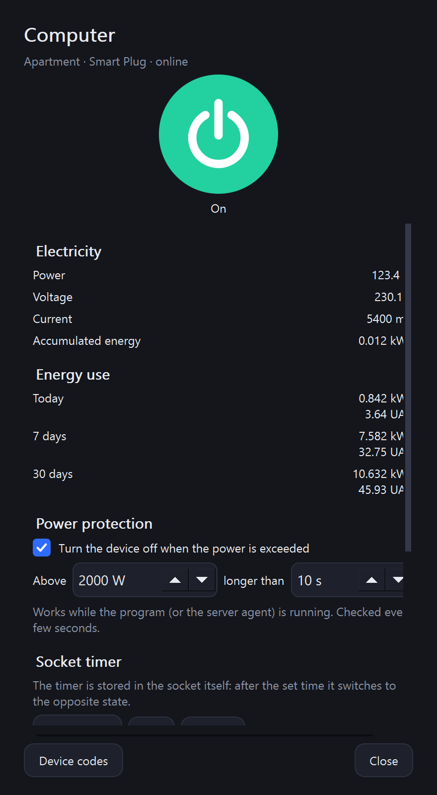

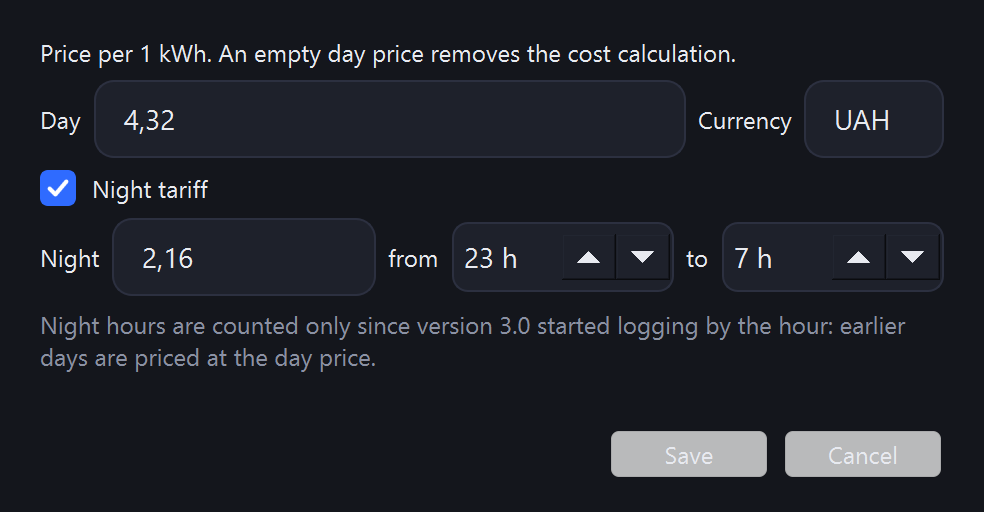

### 17. Shortcuts and notifications

Right-click a tile: “Desktop shortcut: turn on” or “…: turn off”; right-click your own scene: “Desktop shortcut”. The shortcut runs the program without a window: “Working…” appears in the screen corner, then “Turned on: …”. The same commands from the command line: SmartLifeForWindows.exe --device "Name" --on (or --off) and SmartLifeForWindows.exe --scene "Name". Important sockets ask for confirmation before being turned off.

Windows notifications: “⋯” → “Windows notifications”: when a device goes offline or comes back; when a schedule, timer or power protection fired (off by default).

### 18. Server agent

The Server folder (installed with the program; “⋯” → “For a server” → “Open the server agent folder”) contains a windowless agent. It runs your schedules, scenes and power protection on any server or mini computer with Python or Docker while the Windows computer is off. “Prepare the file for a server…” saves a file with the sign-in and settings (it contains the sign-in key of your account: keep it like a password). Enable “A server runs the schedules” so they do not fire twice. Tile timers are not moved to the server. Details: the README in the Server folder.

### 19. Transfer view and tile width

“⋯” → “Transfer view”: “Save the view to a file…” writes the tile order and wide tiles (without the sign-in, scenes and schedules), “Load the view from a file…” applies the file on another computer. Tile width can be changed in the device window (Appearance section) or by right-clicking the tile.

### 20. Device icons

Right-click a tile → “Device icon…” (or the “Device icons…” button in the device window). An icon can be placed in five places:

- next to the name: a large icon under the name and the status, sized to the tile height;
- instead of the power button: the picture fills the whole circle, a green ring means “on”, a grey icon means “off”;
- as the tile background;
- as the device window background (opened by clicking a tile);
- as the background of all program windows.

Choose the place in the “Where to put” list, then a ready picture, “Emoji…” (hundreds of emoji or your own pasted into the field), “Own file…”, “From clipboard”, or drag a file into the window. You can also drop a file straight onto a tile or into the device window: the program asks “Where to put the icon?” and prepares the picture for the chosen place (without margins for the button and backgrounds, square for the icon next to the name). Any file works: a picture, an animated GIF or WebP, an exe or folder icon, a video.

Each place keeps its own icon: changing one does not touch the others. “Remove here” removes the icon only in that place, “Remove everywhere” removes all of them; right-click a tile → “Remove all icons”. Icons are visible only in this program; they do not change in the Smart Life app.

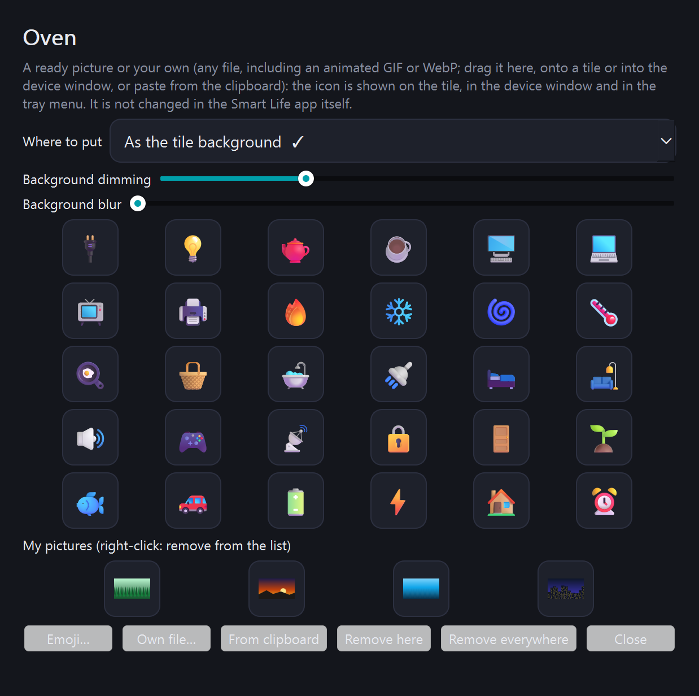

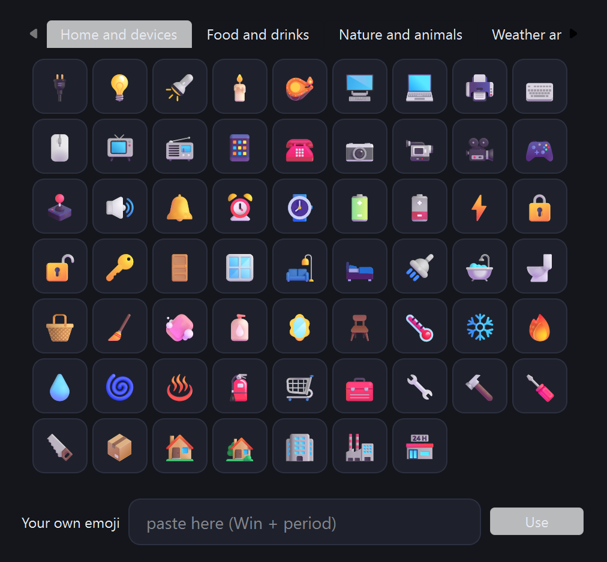

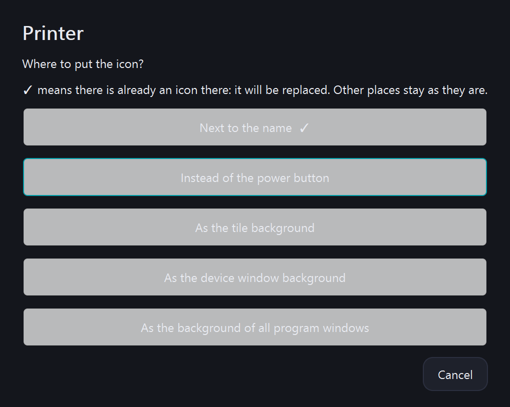

### 21. Backgrounds of tiles, windows and the program

The tile background and the device window background are set in the same “Device icons…” window (the places “As the tile background” and “As the device window background”). The background of all program windows is the place “As the background of all program windows” or “⋯” → “Window background…”, where you can also choose your own colour.

Every background has two sliders: “Dimming” and “Blur”. In “⋯” → “Window background…” the “Card and card-window backgrounds” section gathers them all: an “All at once” row and a separate row for each background.

Over a background the labels choose their colour by the brightness of the picture under them: light text on dark, black on light, with a thin outline (bold text) or a soft glow (regular text). The font size and style do not change. Pictures for a background are prepared in good quality (up to 1280 or 1600 pixels), videos up to 30 seconds.

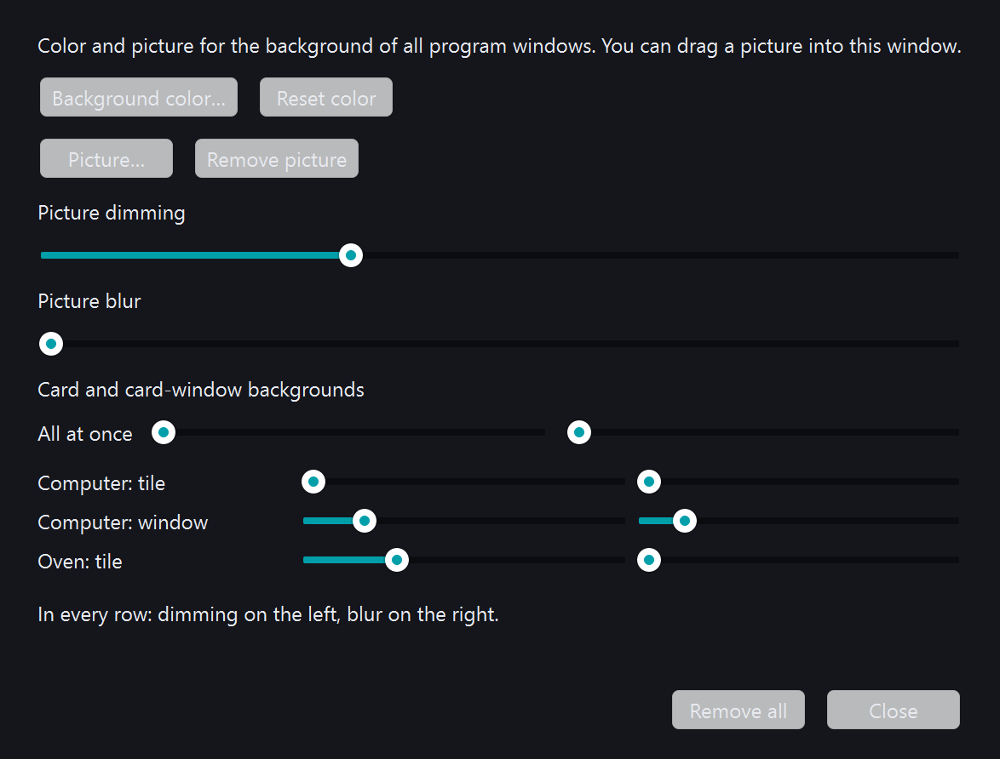

### 22. Video and animation in icons

You can set an animation like this: drop a GIF or WebP on a tile (they stay as they are, up to 8 MB) or a video (mp4, mkv, avi, mov, webm and others). For a video the “Icon from a video” window opens: move the left handle (start) and the right handle (end); the window shows the frame at the handle you are moving. The part is 0.5 to 30 seconds long and the program builds a light animation: the longer the part, the fewer the frames per second and the smaller the picture (a long part takes a few megabytes). For a long video switch on “Zoom the timeline”: the scale shows only the area around the part and the time labels at its ends. Start and end can also be adjusted with numbers.

The animation runs only while the icon is visible on screen; the tray menu shows the first frame. Sound is not used, a video has no transparency.

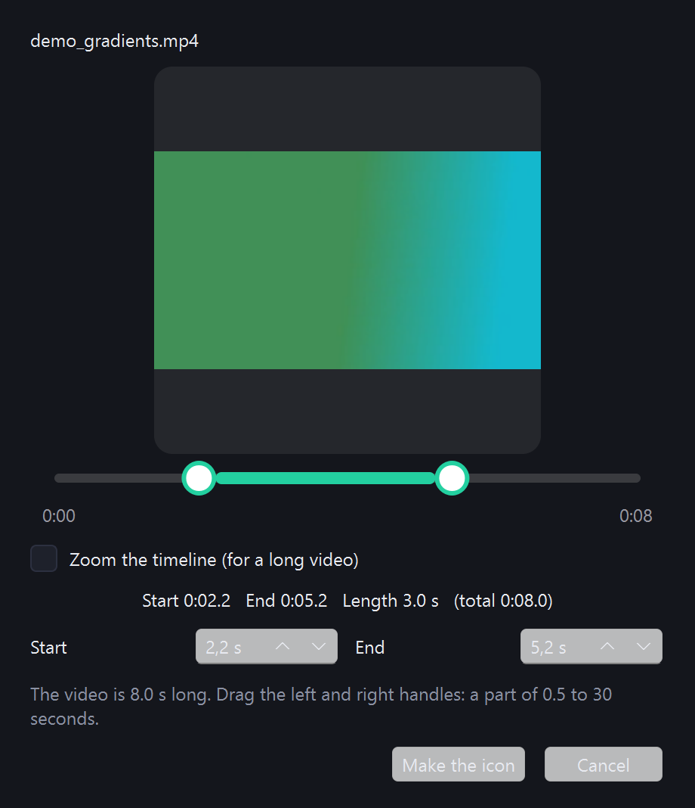

### 23. Where the data is stored

All data lives in your Windows profile: %APPDATA%\SmartLifeForWindows\данные\.

- session.json: the access key to your sockets. Never share this file.
- settings.json: theme, language, window sizes and positions, your scenes and schedules, the user code.
- config.json: the list of important sockets (protected), tiles that are wide by default (wide), the default tile order (order) and the refresh period (refresh_seconds).
- energy.json: energy use by day and hour, and energy given to the grid.
- значки\ and фоны\: your pictures for icons and backgrounds.
- profiles.json: the code assignment for device models.
- devices_cache.json: the remembered device list for fast shortcuts.

The program talks only to Tuya servers, sends nothing to the developer, and has no ads or analytics. It needs neither your password nor your email.

### 24. Limitations

- The program is unofficial and not affiliated with Tuya or Smart Life. For QR sign-in it uses the public identifier of the Home Assistant integration.
- Devices with a switch are controlled (sockets, relays, plain lamps). Sensors, cameras, colour lamps and the like are not controlled; a device without a switch is shown as “no switch”.
- Smart Life automations are not available through this interface.
- Your own scenes and schedules work only while the program is running (you can minimize the window to the tray and the program keeps working; after “Quit” or when the computer is off, schedules do not run; the server agent covers work without the computer).
- Tested on Windows 11 with a Smart Life account (two homes, about 30 sockets). 64-bit Windows 10 or 11 is required.

## Built with

Python and Qt (PySide6, LGPL), the official Tuya Device Sharing SDK (MIT), flag images from flagcdn.com. The program is unofficial and not affiliated with Tuya or Smart Life.

## News and help

- Telegram: [t.me/PhoneInWindowSound](https://t.me/PhoneInWindowSound)

## Support the project

The program is free. If it is useful to you, you can support its development by card, Google Pay or USDT. For USDT use the TRON (TRC20) network only: coins sent through another network are lost.

- By card or Google Pay (from 50 UAH): https://secure.wayforpay.com/button/bba92579a4647
- USDT (TRON TRC20): `TXk32CLkwJryTqhmkw6urcM5CacJgPsSpJ`
