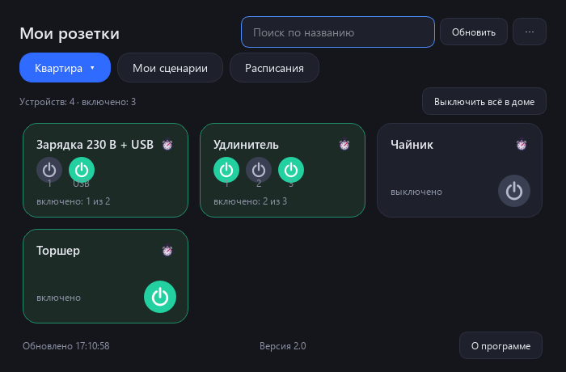
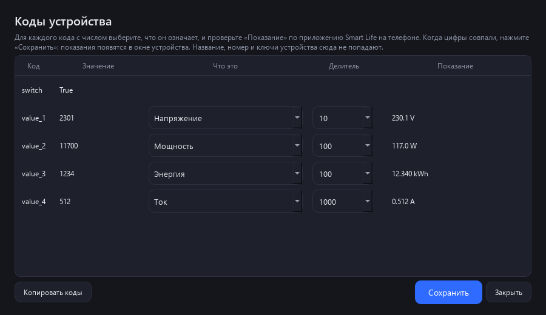
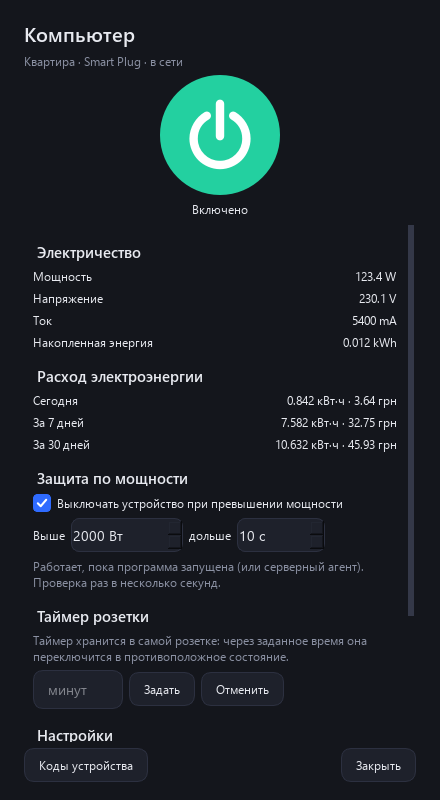

[English](README.md) · [Українська](README.uk.md) · [Русский](README.ru.md)

🌐 Все наши программы: https://drugoj00.github.io/

# Smart Life для Windows

Умные розетки Smart Life в окне Windows: плитки с кнопками, таймеры, свои сценарии и расписания.

Бесплатная программа для Windows, которая показывает розетки и выключатели вашего аккаунта Smart Life (Tuya) в одном аккуратном окне. Включайте и выключайте их мышью, ставьте таймеры, собирайте свои сценарии, запускайте расписания и открывайте каждый дом в отдельном окне. Вход без пароля: вы один раз наводите сканер Smart Life на QR-код в окне программы.

⭐ Если программа полезна, поставьте звезду этому репозиторию: это ничего не стоит и помогает другим её найти.

## Скачать

**Версия 2.0.** [SmartLifeForWindows-2.0.exe](https://github.com/drugoj00/smart-life-for-windows/releases/latest) (Assets) · [Releases](https://github.com/drugoj00/smart-life-for-windows/releases)

SHA-256: `78fe9b75522227313845a7bbbb35071ad95d0f9cd60890fa864b303a94eca809`

## Что нового в 2.0

- «Коды устройства»: назначение мощности, напряжения, тока и энергии вручную; автоопределение блока Tuya.
- Учёт электроэнергии за день, 7 и 30 дней и стоимость; защита по мощности.
- Ярлыки на рабочий стол для розеток и сценариев; уведомления Windows.
- Серверный агент: расписания работают при выключенном компьютере.
- Быстрее: ярлык выполняется за секунду, статус розетки в окне меняется сразу.
- «О программе», перенос вида, подсказки у всех кнопок, плотные меню.
- Плитку можно растянуть на две колонки: флажок «Широкая плитка» в окне устройства.
- Исправлено: в «Установке и удалении программ» показывалась версия 1.0.

## Возможности

- Плитки розеток по домам: название, состояние (включено, выключено, не в сети), большая круглая кнопка питания как в приложении Smart Life. Состояние обновляется само каждые 12 секунд.
- Широкие плитки: любую плитку можно растянуть на две колонки правой кнопкой мыши или флажком «Широкая плитка» в окне устройства (как карточку «P C» в приложении).
- Окно устройства: щелчок по плитке открывает окно с большой кнопкой, электричеством (мощность, напряжение, ток, энергия), таймером розетки и настройками, как в приложении Smart Life.
- Порядок плиток: перетаскивайте плитки мышью, порядок запоминается для каждого дома (по умолчанию как отдаёт Tuya).
- Таймер выключения на каждой плитке (15 минут, 30 минут, 1, 2 или 4 часа).
- Составные розетки и удлинители: у устройства с несколькими каналами (230 В и USB, розетка 1, 2, 3) на плитке и в окне устройства по кнопке на каждый канал; общее «включить/выключить» (меню у часов, «Выключить всё», сценарии, расписания, таймер) действует на все каналы.
- Подтверждение перед выключением важных розеток (компьютер, роутер и другие, список меняется).
- Кнопка «Выключить всё в доме» (важные розетки не затрагиваются).
- Отдельное окно для каждого дома: правая кнопка мыши на кнопке дома. Окна запоминают размер и положение и открываются снова при запуске.
- Значок у часов (трей): щелчок по нему показывает или прячет окно; в меню избранные розетки (● включена, ○ выключена; добавляются правой кнопкой по плитке → «Показывать в меню у часов»), все розетки по домам, «Выключить всё в доме», свои сценарии и «Выход». Крестик окна только прячет его: программа и значок остаются у часов. «Запускать вместе с Windows (в трее)» включается в меню значка у часов и в меню «⋯»: программа стартует при входе в Windows только значком, без окна.
- Свои сценарии: набор розеток с действием «включить» или «выключить», запуск одной кнопкой.
- Расписания: в нужное время и дни недели включить или выключить розетку или запустить свой сценарий.
- Сценарии Smart Life (мгновенные) запускаются отдельной вкладкой, если они у вас есть.
- Светлая и тёмная тема, русский, украинский и английский язык (по языку Windows или вручную).
- Плитки сами подстраиваются под размер окна: все влезают целиком, при тесноте появляется прокрутка по рядам.
- Вход по QR-коду без пароля (код пользователя запоминается), а также запасной вход по почте и паролю со списком стран.
- Коды устройства: таблица назначения мощности, напряжения, тока и энергии для любых устройств; автоопределение блока Tuya, вставка кодов из присланного текста.
- Учёт электроэнергии: расход за сегодня, 7 и 30 дней и стоимость по вашей цене за кВт·ч.
- Защита по мощности: устройство выключается, если мощность выше порога дольше заданного времени.
- Ярлыки на рабочий стол для розеток и своих сценариев: запуск без окна, сообщение о результате за секунду.
- Уведомления Windows: устройство пропало из сети или появилось, сработали расписание, таймер или защита.
- Серверный агент: расписания, сценарии и защита по мощности работают при выключенном компьютере (папка «Сервер»).
- Перенос вида: порядок и широкие плитки сохраняются в файл и загружаются на другом компьютере.
- Подсказки у всех кнопок, плотные меню и списки, у включённых флажков нарисованная галочка, окно «О программе».

## Скриншоты

## Требования

Windows 10 или 11 (64-бит); аккаунт Smart Life (или Tuya Smart) и телефон с приложением для первого входа; интернет. Права администратора не обязательны.

## Подробная инструкция

### 1. Установка

Скачайте установщик SmartLifeForWindows-2.0.exe и запустите его. Windows спросит разрешение: программа ставится в C:\Program Files\SmartLifeForWindows. Если отказать, она встанет в папку пользователя. В окне установки можно добавить ярлык на рабочий стол (по умолчанию его нет) и сразу запустить программу. Ярлык в меню «Пуск» создаётся всегда. Язык установщика (русский, украинский, английский) выбирается по языку Windows, его можно сменить списком в правом верхнем углу окна.

Удаляется программа обычным способом: «Параметры Windows» → «Приложения». Установщик спросит, удалять ли сохранённый вход.

Установщик пока не подписан сертификатом издателя, поэтому Windows может показать предупреждение SmartScreen («Неизвестный издатель»): нажмите «Подробнее», затем «Всё равно выполнить».

### 2. Первый вход (один раз)

Программа не просит ни почту, ни пароль. Вход идёт через QR-код, как в Home Assistant:

1. В приложении Smart Life откройте «Профиль» → значок шестерёнки → «Учётная запись и безопасность» → «Код пользователя» и скопируйте или запомните его (около 7 символов).
2. В программе на вкладке «По коду (QR)» введите код (если он уже скопирован в буфер обмена, он подставится сам) и нажмите «Дальше». Появится QR-код.
3. В Smart Life откройте «Профиль», нажмите значок сканера вверху справа и наведите на QR-код в окне. Подтвердите вход на телефоне.

Входить можно с аккаунта, созданного через Google или по почте: программа пароля не видит, она получает от Tuya только разрешение на управление розетками.

Код пользователя запоминается. Дальше программа входит сама, а сессию сама продлевает: сканировать больше не нужно, пока вы не нажмёте «Выйти» или Tuya не сбросит сессию (раз в несколько месяцев). После «Выйти» QR-код появляется сразу, остаётся навести сканер.

### 3. Главное окно

Вверху кнопка с названием текущего дома: нажмите на неё, и раскроется список всех домов аккаунта (как в приложении Smart Life), выберите нужный. Программа запоминает последний открытый дом (вкладки «Мои сценарии» и «Расписания» не запоминаются). Рядом вкладки «Мои сценарии» и «Расписания»; на них справа от названия дома появляется кнопка «← Назад», она возвращает в тот дом, где вы были. Ниже плитки розеток выбранного дома. На плитке: название, состояние (включено, выключено, не в сети) и круглая кнопка питания: зелёная, если включено, серая, если выключено, затемнённая и пунктирная рамка, если устройство не в сети. Нажмите кнопку, чтобы переключить розетку. Поиск вверху находит розетки по названию, «Обновить» обновляет состояние сразу (иначе оно обновляется само раз в 12 секунд). Состояние розеток, переключённых в телефоне, программа подхватывает через несколько секунд.

### 4. Широкие плитки

В приложении Smart Life некоторые карточки (например, «P C») занимают две колонки. Это зависит от настроек самого приложения и по данным устройства не видно, поэтому в программе вы выбираете ширину сами: правая кнопка мыши на плитке → «Растянуть на две колонки» (и «Обычный размер», чтобы вернуть). Широкие плитки стоят первыми, выбор запоминается. Можно задать широкие плитки заранее списком названий: файл config.json, ключ wide (например, ["P C"]).

### 5. Окно устройства

Щёлкните по плитке (не по кнопке питания): откроется окно устройства, как в приложении. В нём большая кнопка включения, электричество (мощность, напряжение, ток, накопленная энергия, если розетка их измеряет), таймер розетки (через сколько минут она сама переключится), защита от детей и подсветка индикатора. Настройки доступны при входе по QR; данные обновляются сами. Плитки по-прежнему можно перетаскивать за фон: щелчок открывает окно, а перетаскивание меняет порядок.

### 6. Порядок плиток

Tuya отдаёт сторонним программам устройства в своём порядке (по времени добавления), а порядок карточек в приложении Smart Life (например, в «Избранном») хранится внутри приложения и наружу не отдаётся. Поэтому порядок в программе настраивается отдельно: возьмите плитку мышью за фон (не за кнопку питания) и перетащите на место другой плитки, она встанет на её место. Порядок запоминается для каждого дома и действует в окнах домов. Перетаскивание работает в доме без поиска. Меню «⋯» → «Сбросить порядок плиток» возвращает порядок Tuya. Порядок можно задать заранее в config.json: ключ order, например {"Квартира": ["P C", "Принтер"]}.

### 7. Таймер выключения

Нажмите значок будильника в углу плитки и выберите «Выключить через 15 минут / 30 минут / 1 час / 2 часа / 4 часа». Если розетка выключена, она сначала включится, потом выключится по таймеру. На плитке видно, сколько осталось. Таймер можно отменить в том же меню. Таймеры работают, пока программа запущена, и общие для всех окон программы.

### 8. Важные розетки и «Выключить всё»

Перед выключением важных розеток (по умолчанию «P C», «K O M P», «L E N O V O» и «Роутер») программа спрашивает подтверждение, чтобы случайный щелчок не отключил компьютер или интернет. Список можно изменить: файл config.json в папке данных программы (см. раздел «Где хранятся данные»), ключ protected.

Кнопка «Выключить всё в доме» выключает все включённые розетки выбранного дома, кроме важных, и перед этим спрашивает подтверждение. Такая же кнопка есть в отдельных окнах домов.

### 9. Отдельное окно для каждого дома

Нажмите на кнопку с названием дома вверху → «Открыть в отдельном окне» → нужный дом (или нажмите на эту кнопку правой кнопкой мыши: откроется окно текущего дома). Окно дома можно поставить на второй монитор или рядом с другими окнами. В нём есть свой поиск и кнопка «Выключить всё». Окна запоминают размер и положение, а открытые окна снова открываются при следующем запуске. Закрыть окно можно крестиком или тем же меню («Закрыть отдельное окно»). Состояние розеток и таймеры у всех окон общие.

### 10. Мои сценарии

Вкладка «Мои сценарии»: нажмите «+ Создать сценарий», введите название, отметьте розетки и выберите для каждой «Включить» или «Выключить», нажмите «Сохранить». Сценарий запускается кнопкой «Запустить» на его плитке. Правая кнопка мыши на плитке: «Изменить» или «Удалить». Если в сценарии выключаются важные розетки, программа спросит подтверждение. Свои сценарии хранятся в программе (не в Smart Life) и работают, пока программа запущена.

### 11. Расписания

Вкладка «Расписания»: «+ Добавить расписание» → выберите, что включать или выключать (розетку или свой сценарий), действие, время и дни недели. Переключатель «Вкл/Выкл» на плитке временно отключает расписание, правая кнопка мыши: «Изменить» или «Удалить». Расписания срабатывают, только пока программа запущена и компьютер не спит. Для круглосуточной работы используйте автоматизации в самом Smart Life.

### 12. Сценарии Smart Life

Если в приложении Smart Life у вас есть «мгновенные сценарии» (нажал и выполнилось), в программе появится вкладка «Сценарии» с кнопкой «Запустить» для каждого. Автоматизации Smart Life (по расписанию и условиям) Tuya не отдаёт сторонним программам: в программе их не видно, и они продолжают работать в приложении как раньше.

### 13. Тема, язык, размер окна

Кнопка «⋯» в правом верхнем углу: «Тема» (Авто как в Windows, Светлая, Тёмная), «Язык» (Авто, Русский, Українська, English; после выбора программа перезапускается) и «Выйти из аккаунта». Язык по умолчанию берётся из языка Windows.

Крестик окна только прячет его к часам: программа и значок остаются, выход — правой кнопкой по значку у часов → «Выход». В том же меню есть флажок «Запускать вместе с Windows (в трее)» (при входе в Windows программа стартует свёрнутой в трей). Значок у часов: щелчок показывает или прячет окно, правая кнопка открывает меню: открыть окно, избранные розетки (отметка ● включена, ○ выключена; щелчок переключает, важные розетки спрашивают подтверждение), «Все розетки» по домам, «Выключить всё в доме», «Мои сценарии», «Выход». Избранное задаётся правой кнопкой по плитке → «Показывать в меню у часов».

При самом первом запуске окно узкое (две колонки). Размер и положение окон запоминаются. Если все плитки не помещаются в окно, они становятся компактнее; когда и так тесно, появляется прокрутка, и колесо мыши листает по одному ряду, последний ряд не обрезается.

### 14. Вход по почте и паролю (запасной)

На экране входа есть вкладка «По почте и паролю»: почта, пароль, страна аккаунта (список с флагами) и тип приложения. Это старый способ Tuya: он показывает общий список устройств без разделения по домам и без сценариев и принимает не все аккаунты (у части аккаунтов Tuya отвечает «неверный логин», даже если пароль верный). Вход через Google здесь невозможен. Надёжнее вход по QR-коду.

### 15. Коды устройства

Если у устройства не видны мощность и напряжение, откройте окно устройства и нажмите «Коды устройства». В таблице для каждого кода с числом выберите, что он означает (мощность, напряжение, ток, энергия), при необходимости поставьте делитель (10, 100, 1000) и сверьте столбец «Показание» с приложением Smart Life. Нажмите «Сохранить»: показания появятся в блоке «Электричество», настройка запомнится для всех устройств этой модели. Стандартный блок Tuya (phase_a) определяется автоматически.

«Копировать коды» копирует список кодов текстом (без названия, номера и ключей устройства), чтобы отправить его разработчику. «⋯» → «Вставить коды устройства…» разбирает такой текст, присланный другим пользователем.

### 16. Электроэнергия и защита по мощности

В окне устройства с замером мощности или счётчиком энергии показан расход за сегодня, 7 и 30 дней (считается, пока программа запущена). «⋯» → «Цена электроэнергии…»: цена за кВт·ч с названием денежной единицы, например «4,32 грн»; рядом с расходом появится стоимость.

Защита по мощности: в окне устройства включите «Выключать при превышении» и задайте ватты и секунды. Когда мощность выше порога дольше заданного времени, устройство выключается один раз. Защита работает, пока запущена программа или серверный агент.

### 17. Ярлыки и уведомления

Правая кнопка по плитке: «Ярлык на рабочий стол: включить» или «…: выключить»; правая кнопка по своему сценарию: «Ярлык на рабочий стол». Ярлык запускает программу без окна: в углу экрана появляется «Выполняется…», затем «Включено: …». Те же команды из командной строки: SmartLifeForWindows.exe --device "Название" --on (или --off) и SmartLifeForWindows.exe --scene "Название". Важные розетки при выключении спрашивают подтверждение.

Уведомления Windows: «⋯» → «Уведомления Windows»: когда устройство пропало из сети или появилось; когда сработали расписание, таймер или защита по мощности (по умолчанию выключены).

### 18. Серверный агент

Папка «Сервер» (устанавливается вместе с программой; «⋯» → «Для сервера» → «Открыть папку с серверным агентом») содержит агента без окна. Он выполняет ваши расписания, сценарии и защиту по мощности на любом сервере или мини-компьютере с Python или Docker, когда компьютер с Windows выключен. «Подготовить файл для сервера…» сохраняет файл со входом и настройками (в нём ключ входа в аккаунт: храните как пароль). Включите «Расписания выполняет сервер», чтобы расписания не срабатывали дважды. Таймеры с плиток на сервер не переносятся. Подробности: «ЧИТАЙ_МЕНЯ» в папке «Сервер».

### 19. Перенос вида и ширина плиток

«⋯» → «Перенести вид»: «Сохранить вид в файл…» записывает порядок плиток и широкие плитки (без входа, сценариев и расписаний), «Загрузить вид из файла…» применяет файл на другом компьютере. Ширину плитки можно менять в окне устройства (раздел «Вид») или правой кнопкой по плитке.

### 20. Где хранятся данные

Все данные лежат в вашем профиле Windows: %APPDATA%\SmartLifeForWindows\данные\.

- session.json: ключ доступа к вашим розеткам. Никому не передавайте этот файл.
- settings.json: тема, язык, размер и положение окон, ваши сценарии и расписания, код пользователя.
- config.json: список важных розеток (protected), широких плиток по умолчанию (wide), порядок плиток по умолчанию (order) и период обновления (refresh_seconds).
- energy.json: расход электроэнергии по дням.
- profiles.json: назначение кодов для моделей устройств.
- devices_cache.json: запомненный список устройств для быстрых ярлыков.

Программа обращается только к серверам Tuya, ничего не отправляет разработчику, в ней нет рекламы и статистики. Пароль и почта программе не нужны.

### 21. Ограничения

- Программа неофициальная и не связана с Tuya или Smart Life. Для входа по QR она использует открытый идентификатор интеграции Home Assistant.
- Управляются устройства с выключателем (розетки, реле, лампы без цвета). Датчики, камеры, цветные лампы и подобное не управляются; устройство без выключателя показывается с пометкой «нет выключателя».
- Автоматизации Smart Life через этот интерфейс недоступны.
- Свои сценарии и расписания работают только пока программа запущена (окно можно свернуть в трей, программа продолжит работать; после «Выход» или выключения компьютера расписания не выполняются; для работы без компьютера есть серверный агент).
- Проверено на Windows 11 с аккаунтом Smart Life (два дома, около 30 розеток). Нужна 64-разрядная Windows 10 или 11.

## На чём сделана

Python и Qt (PySide6, LGPL), официальная библиотека Tuya Device Sharing SDK (MIT), картинки флагов flagcdn.com. Программа неофициальная и не связана с Tuya или Smart Life.

## Новости и помощь

- Telegram: [t.me/PhoneInWindowSound](https://t.me/PhoneInWindowSound)

## Поддержать проект

Программа бесплатная. Если она вам полезна, можно поддержать разработку банковской картой, Google Pay или USDT. Для USDT только сеть TRON (TRC20): монеты, отправленные по другой сети, теряются.

- Картой или Google Pay (от 50 грн): https://secure.wayforpay.com/button/bba92579a4647
- USDT (TRON TRC20): `TXk32CLkwJryTqhmkw6urcM5CacJgPsSpJ`
