[English](README.md) · [Українська](README.uk.md) · [Русский](README.ru.md)

🌐 Усі наші програми: https://drugoj00.github.io/

# Smart Life для Windows

Розумні розетки Smart Life у вікні Windows: плитки з кнопками, таймери, власні сценарії та розклади.

Безкоштовна програма для Windows, яка показує розетки й вимикачі вашого акаунта Smart Life (Tuya) в одному охайному вікні. Вмикайте та вимикайте їх мишею, ставте таймери, збирайте власні сценарії, запускайте розклади й відкривайте кожен дім в окремому вікні. Вхід без пароля: ви один раз наводите сканер Smart Life на QR-код у вікні програми.

⭐ Якщо програма корисна, поставте зірку цьому репозиторію: це нічого не коштує й допомагає іншим її знайти.

## Завантажити

**Версія 1.0.** [SmartLifeForWindows-Setup-1.0.exe](https://github.com/drugoj00/smart-life-for-windows/releases/latest) (Assets) · [Releases](https://github.com/drugoj00/smart-life-for-windows/releases)

SHA-256: `856687083e8f6f6ed2ea60a5db03d2f4694c36236c1a9ccd70ac3d53919538be`

## Можливості

- Плитки розеток за домами: назва, стан (увімкнено, вимкнено, не в мережі), велика кругла кнопка живлення як у застосунку Smart Life. Стан оновлюється сам кожні 12 секунд.
- Широкі плитки: будь-яку плитку можна розтягнути на дві колонки правою кнопкою миші (як картку «P C» у застосунку).
- Вікно пристрою: клік по плитці відкриває вікно з великою кнопкою, електрикою (потужність, напруга, струм, енергія), таймером розетки й налаштуваннями, як у застосунку Smart Life.
- Порядок плиток: перетягуйте плитки мишею, порядок запам'ятовується для кожного дому (за замовчуванням як віддає Tuya).
- Таймер вимкнення на кожній плитці (15 хвилин, 30 хвилин, 1, 2 або 4 години).
- Підтвердження перед вимкненням важливих розеток (комп'ютер, роутер та інші, список змінюється).
- Кнопка «Вимкнути все в домі» (важливі розетки не зачіпаються).
- Окреме вікно для кожного дому: права кнопка миші на кнопці дому. Вікна запам'ятовують розмір і положення та відкриваються знову під час запуску.
- Власні сценарії: набір розеток із дією «увімкнути» або «вимкнути», запуск однією кнопкою.
- Розклади: у потрібний час і дні тижня увімкнути чи вимкнути розетку або запустити власний сценарій.
- Сценарії Smart Life (миттєві) запускаються окремою вкладкою, якщо вони у вас є.
- Світла й темна тема, українська, російська та англійська мова (за мовою Windows або вручну).
- Плитки самі підлаштовуються під розмір вікна: усі вміщуються повністю, у тісному вікні з'являється прокручування по рядах.
- Вхід за QR-кодом без пароля (код користувача запам'ятовується), а також запасний вхід за поштою й паролем зі списком країн.

## Знімки екрана

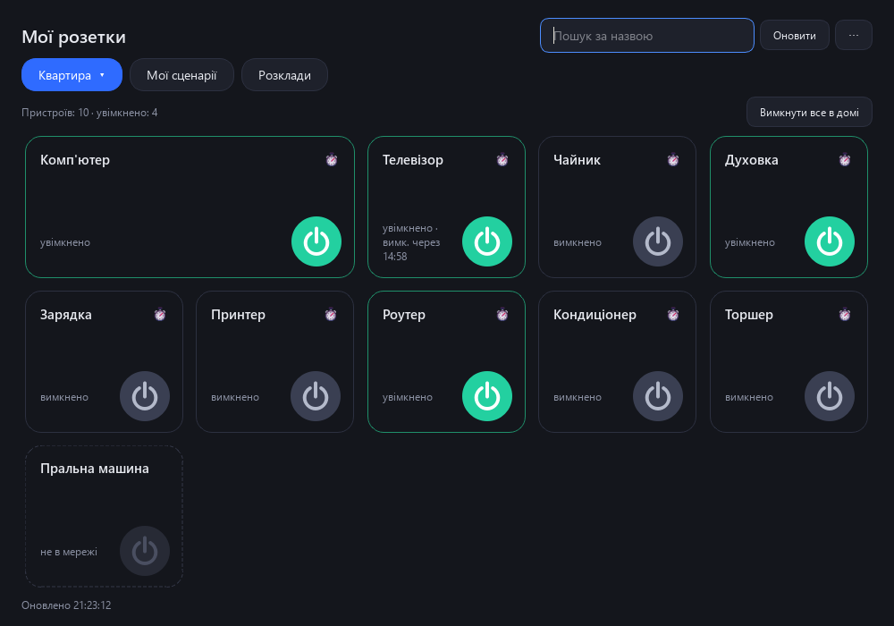

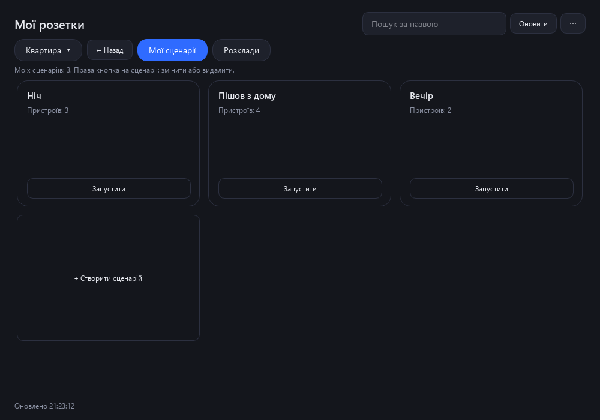

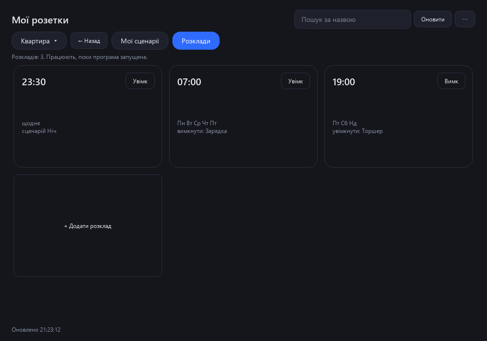

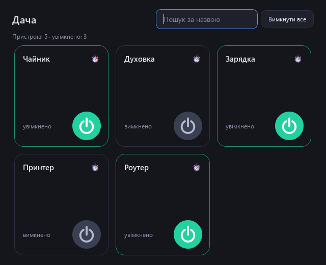

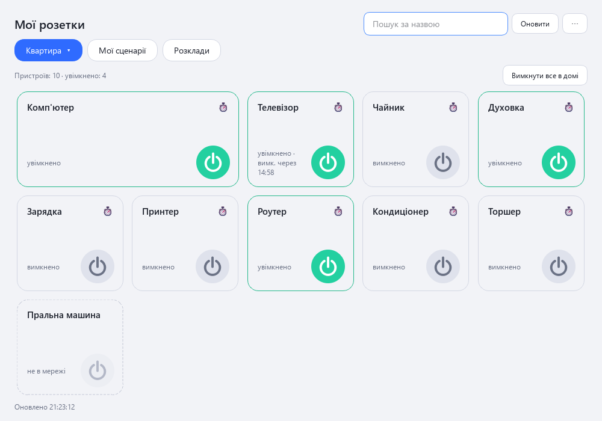

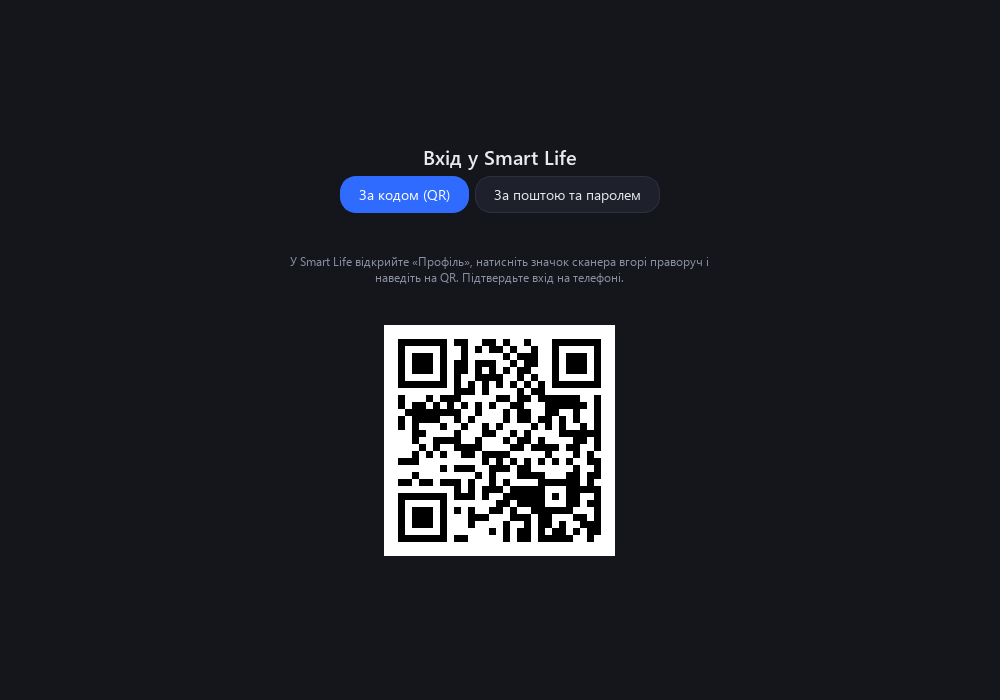

## Вимоги

Windows 10 або 11 (64-біт); акаунт Smart Life (або Tuya Smart) і телефон із застосунком для першого входу; інтернет. Права адміністратора не обов'язкові.

## Докладна інструкція

### 1. Встановлення

Завантажте встановлювач SmartLifeForWindows-Setup-1.0.exe (близько 59 МБ) і запустіть його. Windows запитає дозвіл: програма встановлюється в C:\Program Files\SmartLifeForWindows. Якщо відмовити, вона стане в папку користувача. У вікні встановлення можна додати ярлик на робочий стіл (за замовчуванням його немає) і одразу запустити програму. Ярлик у меню «Пуск» створюється завжди. Мова встановлювача (українська, російська, англійська) вибирається за мовою Windows, її можна змінити списком у правому верхньому куті вікна.

Видаляється програма звичайним способом: «Параметри Windows» → «Застосунки». Встановлювач запитає, чи видаляти збережений вхід.

Встановлювач поки не підписаний сертифікатом видавця, тож Windows може показати попередження SmartScreen («Невідомий видавець»): натисніть «Докладніше», потім «Все одно виконати».

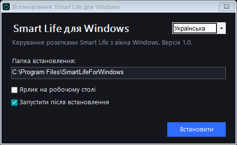

### 2. Перший вхід (один раз)

Програма не просить ні пошту, ні пароль. Вхід іде через QR-код, як у Home Assistant:

1. У застосунку Smart Life відкрийте «Профіль» → значок шестірні → «Обліковий запис і безпека» → «Код користувача» та скопіюйте або запам'ятайте його (близько 7 символів).
2. У програмі на вкладці «За кодом (QR)» введіть код (якщо він уже скопійований у буфер обміну, він підставиться сам) і натисніть «Далі». З'явиться QR-код.
3. У Smart Life відкрийте «Профіль», натисніть значок сканера вгорі праворуч і наведіть на QR-код у вікні. Підтвердьте вхід на телефоні.

Увійти можна з акаунта, створеного через Google або за поштою: програма пароля не бачить, вона отримує від Tuya лише дозвіл на керування розетками.

Код користувача запам'ятовується. Далі програма входить сама, а сесію сама подовжує: сканувати більше не потрібно, доки ви не натиснете «Вийти» або Tuya не скине сесію (раз на кілька місяців). Після «Вийти» QR-код з'являється одразу, залишається навести сканер.

### 3. Головне вікно

Угорі кнопка з назвою поточного дому: натисніть на неї, і розкриється список усіх домів акаунта (як у застосунку Smart Life), оберіть потрібний. Програма запам'ятовує останній відкритий дім (вкладки «Мої сценарії» та «Розклади» не запам'ятовуються). Поруч вкладки «Мої сценарії» та «Розклади»; на них праворуч від назви дому з'являється кнопка «← Назад», вона повертає в той дім, де ви були. Нижче плитки розеток вибраного дому. На плитці: назва, стан (увімкнено, вимкнено, не в мережі) і кругла кнопка живлення: зелена, якщо увімкнено, сіра, якщо вимкнено, затемнена та пунктирна рамка, якщо пристрій не в мережі. Натисніть кнопку, щоб перемкнути розетку. Пошук угорі знаходить розетки за назвою, «Оновити» оновлює стан одразу (інакше він оновлюється сам раз на 12 секунд). Стан розеток, перемкнених у телефоні, програма підхоплює за кілька секунд.

### 4. Широкі плитки

У застосунку Smart Life деякі картки (наприклад, «P C») займають дві колонки. Це залежить від налаштувань самого застосунку й за даними пристрою не видно, тому в програмі ви обираєте ширину самі: права кнопка миші на плитці → «Розтягнути на дві колонки» (і «Звичайний розмір», щоб повернути). Широкі плитки стоять першими, вибір запам'ятовується. Можна задати широкі плитки заздалегідь списком назв: файл config.json, ключ wide (наприклад, ["P C"]).

### 5. Вікно пристрою

Клікніть по плитці (не по кнопці живлення): відкриється вікно пристрою, як у застосунку. У ньому велика кнопка вмикання, електрика (потужність, напруга, струм, накопичена енергія, якщо розетка їх вимірює), таймер розетки (через скільки хвилин вона сама перемкнеться), захист від дітей і підсвітка індикатора. Налаштування доступні при вході за QR; дані оновлюються самі. Плитки, як і раніше, можна перетягувати за тло: клік відкриває вікно, а перетягування змінює порядок.

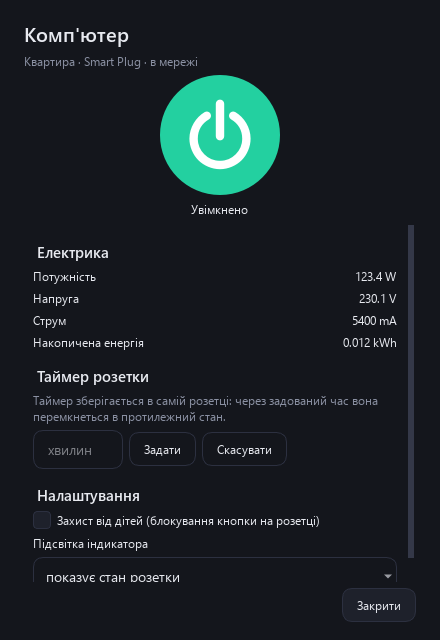

### 6. Порядок плиток

Tuya віддає стороннім програмам пристрої у своєму порядку (за часом додавання), а порядок карток у застосунку Smart Life (наприклад, в «Обраному») зберігається всередині застосунку й назовні не віддається. Тому порядок у програмі налаштовується окремо: візьміть плитку мишею за фон (не за кнопку живлення) і перетягніть на місце іншої плитки, вона стане на її місце. Порядок запам'ятовується для кожного дому й діє у вікнах домів. Перетягування працює в домі без пошуку. Меню «⋯» → «Скинути порядок плиток» повертає порядок Tuya. Порядок можна задати заздалегідь у config.json: ключ order, наприклад {"Квартира": ["P C", "Принтер"]}.

### 7. Таймер вимкнення

Натисніть значок будильника в куті плитки й виберіть «Вимкнути через 15 хвилин / 30 хвилин / 1 годину / 2 години / 4 години». Якщо розетка вимкнена, вона спершу увімкнеться, потім вимкнеться за таймером. На плитці видно, скільки лишилося. Таймер можна скасувати в тому самому меню. Таймери працюють, доки програма запущена, і спільні для всіх вікон програми.

### 8. Важливі розетки та «Вимкнути все»

Перед вимкненням важливих розеток (за замовчуванням «P C», «K O M P», «L E N O V O» та «Роутер») програма питає підтвердження, щоб випадковий клік не вимкнув комп'ютер чи інтернет. Список можна змінити: файл config.json у папці даних програми (див. розділ «Де зберігаються дані»), ключ protected.

Кнопка «Вимкнути все в домі» вимикає всі ввімкнені розетки вибраного дому, крім важливих, і перед цим питає підтвердження. Така сама кнопка є в окремих вікнах домів.

### 9. Окреме вікно для кожного дому

Натисніть на кнопку з назвою дому вгорі → «Відкрити в окремому вікні» → потрібний дім (або натисніть на цю кнопку правою кнопкою миші: відкриється вікно поточного дому). Вікно дому можна поставити на другий монітор або поруч з іншими вікнами. У ньому є власний пошук і кнопка «Вимкнути все». Вікна запам'ятовують розмір і положення, а відкриті вікна знову відкриваються під час наступного запуску. Закрити вікно можна хрестиком або тим самим меню («Закрити окреме вікно»). Стан розеток і таймери в усіх вікон спільні.

### 10. Мої сценарії

Вкладка «Мої сценарії»: натисніть «+ Створити сценарій», введіть назву, позначте розетки й виберіть для кожної «Увімкнути» або «Вимкнути», натисніть «Зберегти». Сценарій запускається кнопкою «Запустити» на його плитці. Права кнопка миші на плитці: «Змінити» або «Видалити». Якщо в сценарії вимикаються важливі розетки, програма спитає підтвердження. Власні сценарії зберігаються в програмі (не в Smart Life) і працюють, доки програма запущена.

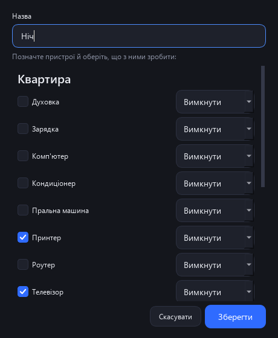

### 11. Розклади

Вкладка «Розклади»: «+ Додати розклад» → виберіть, що вмикати чи вимикати (розетку або власний сценарій), дію, час і дні тижня. Перемикач «Увімк/Вимк» на плитці тимчасово вимикає розклад, права кнопка миші: «Змінити» або «Видалити». Розклади спрацьовують, лише доки програма запущена і комп'ютер не спить. Для цілодобової роботи користуйтеся автоматизаціями в самому Smart Life.

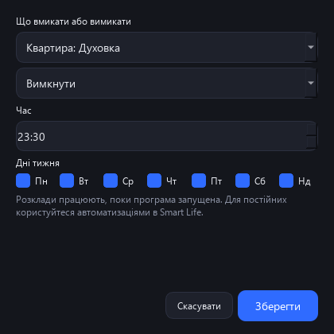

### 12. Сценарії Smart Life

Якщо в застосунку Smart Life у вас є «миттєві сценарії» (натиснув і виконалося), у програмі з'явиться вкладка «Сценарії» з кнопкою «Запустити» для кожного. Автоматизації Smart Life (за розкладом і умовами) Tuya не віддає стороннім програмам: у програмі їх не видно, і вони продовжують працювати в застосунку як раніше.

### 13. Тема, мова, розмір вікна

Кнопка «⋯» у правому верхньому куті: «Світла тема» / «Темна тема», «Мова» (Авто, Русский, Українська, English; після вибору програма перезапускається) і «Вийти з акаунта». Мова за замовчуванням береться з мови Windows.

Під час найпершого запуску вікно вузьке (дві колонки). Розмір і положення вікон запам'ятовуються. Якщо всі плитки не вміщуються у вікно, вони стають компактнішими; коли й так тісно, з'являється прокручування, і колесо миші гортає по одному ряду, останній ряд не обрізається.

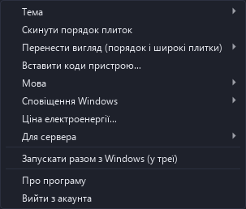

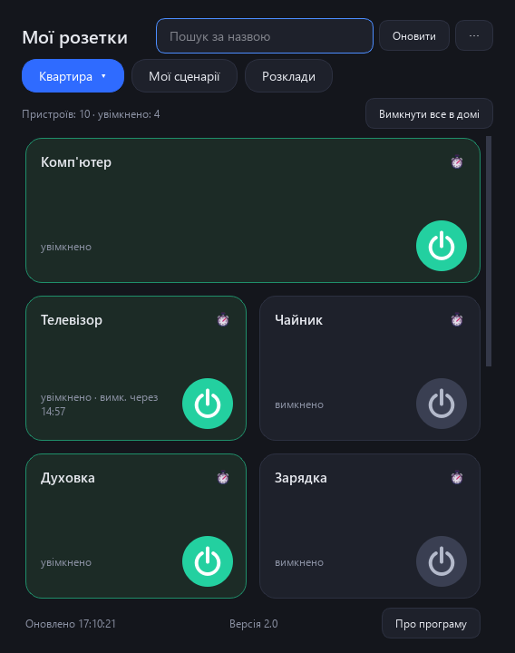

### 14. Вхід за поштою й паролем (запасний)

На екрані входу є вкладка «За поштою та паролем»: пошта, пароль, країна акаунта (список із прапорами) і тип застосунку. Це старий спосіб Tuya: він показує загальний список пристроїв без поділу за домами й без сценаріїв та приймає не всі акаунти (частина акаунтів Tuya відхиляє як «невірний логін», навіть якщо пароль правильний). Вхід через Google тут неможливий. Надійніше вхід за QR-кодом.

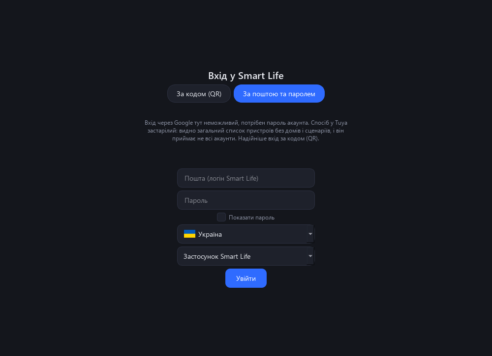

### 15. Де зберігаються дані

Усі дані лежать у вашому профілі Windows: %APPDATA%\SmartLifeForWindows\данные\.

- session.json: ключ доступу до ваших розеток. Нікому не передавайте цей файл.
- settings.json: тема, мова, розмір і положення вікон, ваші сценарії та розклади, код користувача.
- config.json: список важливих розеток (protected), широких плиток за замовчуванням (wide), порядок плиток за замовчуванням (order) і період оновлення (refresh_seconds).

Програма звертається лише до серверів Tuya, нічого не надсилає розробнику, у ній немає реклами й статистики. Пароль і пошта програмі не потрібні.

### 16. Обмеження

- Програма неофіційна й не пов'язана з Tuya чи Smart Life. Для входу за QR вона використовує відкритий ідентифікатор інтеграції Home Assistant.
- Керуються пристрої з вимикачем (розетки, реле, лампи без кольору). Датчики, камери, кольорові лампи тощо не керуються; пристрій без вимикача показується з позначкою «немає вимикача».
- Автоматизації Smart Life через цей інтерфейс недоступні.
- Власні сценарії та розклади працюють, лише доки програма запущена.
- Перевірено на Windows 11 з акаунтом Smart Life (два доми, близько 30 розеток). Потрібна 64-розрядна Windows 10 або 11.

## На чому зроблено

Python і Qt (PySide6, LGPL), офіційна бібліотека Tuya Device Sharing SDK (MIT), зображення прапорів flagcdn.com. Програма неофіційна й не пов'язана з Tuya чи Smart Life.

## Новини та допомога

- Telegram: [t.me/PhoneInWindowSound](https://t.me/PhoneInWindowSound)

## Підтримати проєкт

Програма безкоштовна. Якщо вона вам корисна, можна підтримати розробку банківською карткою, Google Pay або USDT. Для USDT лише мережа TRON (TRC20): монети, надіслані іншою мережею, втрачаються.

- Карткою або Google Pay (від 50 грн): https://secure.wayforpay.com/button/bba92579a4647
- USDT (TRON TRC20): `TXk32CLkwJryTqhmkw6urcM5CacJgPsSpJ`
